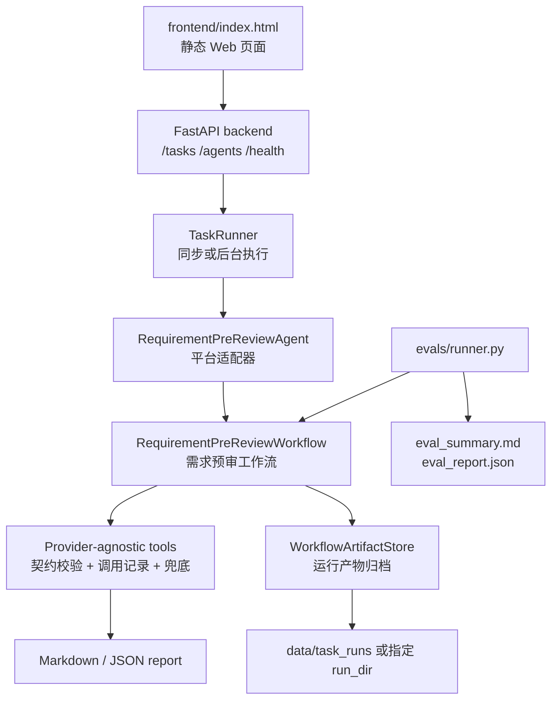

# 需求澄清与方案预审 Agent

面向产品、研发、测试协同评审场景的需求预审 Web 应用。它会在需求进入开发前，对原始需求文本做完整度初检、清晰度门禁、方案草案、风险分类和结构化报告归档。

当前版本是一个独立项目，不依赖修改原始 `hello-agents` 参考仓库。第一版优先保证真实工程闭环：Web 输入、后端任务、工作流执行、Markdown/JSON 输出、产物归档、测试和最小评测 harness。

## 核心能力

- Web 页面提交需求文本、目标用户、明确约束和补充上下文。
- 后端 API 创建任务、同步或后台运行任务、查询任务状态。
- 工作流串联 `Requirement Analyst`、`Solution Architect`、`Risk Reviewer`、`Report Synthesizer` 四类角色。
- 内部工具层提供 `requirement-audit`、`clarity-score`、`risk-taxonomy-check`、`report-export`、`report-quality-check`。
- 清晰度不足时关闭方案门禁，输出待澄清问题，避免过早展开方案。
- 支持根据待确认问题提交二轮澄清回答，生成 V2 报告并输出 V1 / V2 diff。
- 输出固定章节 Markdown 报告和结构化 JSON 报告。
- 保存输入、中间产物、最终报告、工具调用、质量检查、阶段记录和元数据。
- 提供最小 eval harness，用标准 case 检查 schema、章节完整度、门禁一致性、工具错误率和耗时。

## 架构



## 目录结构

```text
.
├── agents/requirement_pre_review/src/   # 工作流、工具契约、提示词、格式化与归档
├── backend/                             # FastAPI、任务管理、平台 Agent 适配
├── frontend/                            # 原生 HTML/CSS/JS 单页界面
├── evals/                               # 最小评测回归 harness 和标准 case
├── examples/order_export_demo/          # 可演示输入与输出样例
├── tests/                               # 单元与集成测试
├── docs/                                # 项目方案与开发计划
├── main.py                              # 后端启动入口
└── smoke_test.py                        # 工程闭环冒烟测试
```

## 环境准备

推荐使用当前项目约定的 conda 环境：

```bash
conda env create -f environment.yml
conda activate agent
```

如果环境已存在，只需确认依赖安装完成：

```bash
python -m pip install -r requirements.txt
```

当前工作流第一版使用 provider-agnostic 的内部工具接口层，核心预审流程不要求真实模型 API key。`.env` 中的 LLM 配置保留给后续接入模型供应商。

## 启动方式

启动后端 API：

```bash
python main.py
```

启动前端静态页：

```bash
python -m http.server 8765 --directory frontend
```

浏览器打开：

```text
http://127.0.0.1:8765
```

页面中的 `API Base URL` 默认指向：

```text
http://127.0.0.1:8000
```

## API 示例

健康检查：

```bash
curl http://127.0.0.1:8000/health
```

查看 Agent：

```bash
curl http://127.0.0.1:8000/agents
```

创建任务：

```bash
curl -X POST http://127.0.0.1:8000/tasks \
  -H 'Content-Type: application/json' \
  -d '{
    "title": "订单导出流程优化",
    "input": "目标是降低客服处理订单导出的人工成本。\n运营和客服需要在后台按时间范围筛选并导出订单。\n本期范围包括筛选、导出、失败重试和导出日志。\n需要复用现有权限模型，并在本月上线。\n依赖订单 API 和导出文件存储。\n性能要求是 1000 条订单 3 分钟内导出完成。\n验收标准是运营可以按订单状态筛选并成功下载导出结果。",
    "agent_id": "requirement_pre_review",
    "metadata": {
      "title": "订单导出流程优化",
      "target_users": ["运营", "客服"],
      "explicit_constraints": ["本月上线", "复用现有权限模型"]
    }
  }'
```

同步运行任务：

```bash
curl -X POST http://127.0.0.1:8000/tasks/<task_id>/run \
  -H 'Content-Type: application/json' \
  -d '{"background": false}'
```

查询任务：

```bash
curl http://127.0.0.1:8000/tasks/<task_id>
```

提交二轮澄清回答并生成 V2：

```bash
curl -X POST http://127.0.0.1:8000/tasks/<task_id>/follow-up \
  -H 'Content-Type: application/json' \
  -d '{
    "title": "订单导出流程优化 V2",
    "answers": [
      {"question_id": "Q-001", "answer": "目标是降低客服处理订单导出的人工成本。"},
      {"question_id": "Q-002", "answer": "目标用户是运营和客服。"}
    ]
  }'
```

返回的任务会在 `artifacts.follow_up` 下包含 V2 报告、结构化 JSON、回答记录、二轮产物路径和 `diff_markdown`。

## 示例输入

完整示例在 [sample_requirement.txt](examples/order_export_demo/sample_requirement.txt)：

```text
目标是降低客服处理订单导出的人工成本。
运营和客服需要在后台按时间范围筛选并导出订单。
本期范围包括筛选、导出、失败重试和导出日志。
需要复用现有权限模型，并在本月上线。
依赖订单 API 和导出文件存储。
性能要求是 1000 条订单 3 分钟内导出完成。
验收标准是运营可以按订单状态筛选并成功下载导出结果。
```

## 示例输出

示例 Markdown 报告见 [sample_report.md](examples/order_export_demo/sample_report.md)，示例 JSON 报告见 [sample_report.json](examples/order_export_demo/sample_report.json)。

这组样例的关键结果：

- 清晰度评分：`99/65`
- 门禁结果：通过
- 风险数量：`4`
- 固定报告章节：`8/8`
- 结构化编号：`REQ-xxx`、`AC-xxx`、`DEC-xxx`

完整工作流产物在 [examples/order_export_demo/artifacts](examples/order_export_demo/artifacts)。

## 评测回归

运行标准 eval suite：

```bash
python -m evals.runner
```

指定输出目录：

```bash
python -m evals.runner --output-dir evals/outputs/manual-check
```

输出文件：

- `eval_summary.md`
- `eval_report.json`
- `cases/<case_id>/case_result.json`
- `cases/<case_id>/workflow_artifacts/`

## 验证

运行完整测试：

```bash
python -m pytest tests
```

运行冒烟测试：

```bash
python smoke_test.py
```

前端静态语法检查：

```bash
node --check frontend/app.js
```

当前已知测试警告：`fastapi.testclient` 依赖的 `starlette.testclient` 对当前 `httpx` 用法给出弃用提示，不影响现阶段功能闭环。

## 当前边界

- 当前版本不包含 RAG、数据库、多用户权限或 Jira/飞书集成。
- LLM 原生 function calling 不是第一版必需路径，当前先以内部函数/工具接口层保证稳定工程闭环。
- 前端是原生静态页面，后端是 FastAPI；两者可分别启动，适合本地演示。
