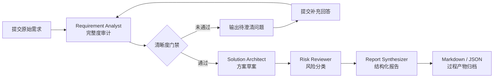
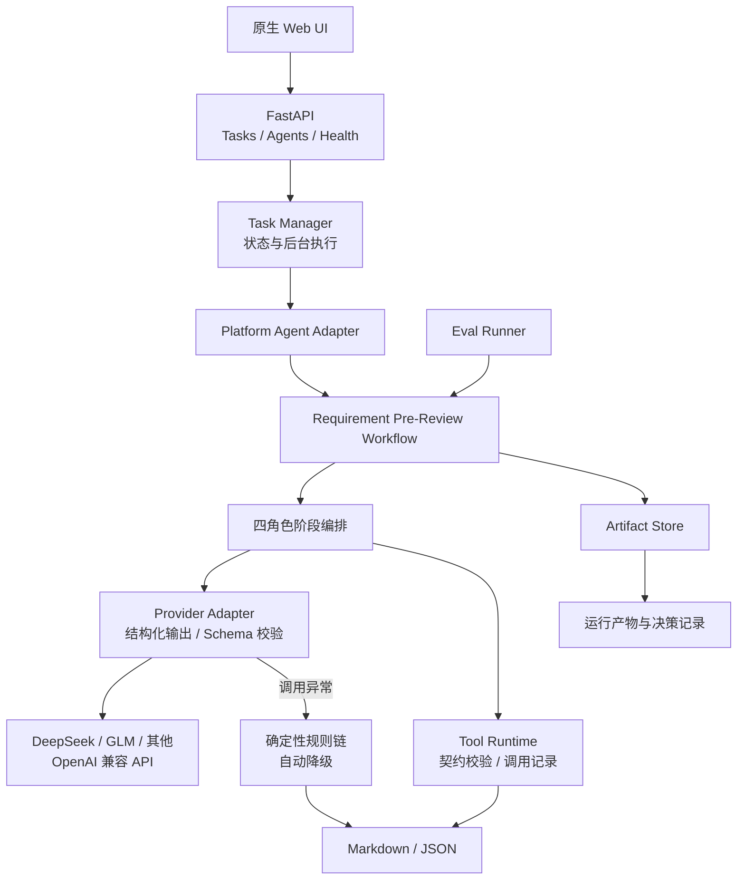

# 需求澄清与方案预审 Agent

一个面向产品、研发和测试协作场景的个人 AI 应用工程项目：在需求进入开发前，自动识别信息缺口、执行清晰度门禁、生成方案草案与风险清单，并将评审结果沉淀为可追踪的结构化报告。

> 项目重点不是用单个 Prompt 包装一次模型调用，而是设计一条可解释、可测试、可追踪的 Agent Workflow，并补齐 Web、API、任务管理、产物归档和评测回归等工程环节。

## 项目概览


| 项目维度 | 说明                                                                   |
| -------- | ---------------------------------------------------------------------- |
| 解决问题 | 模糊需求直接进入开发后，容易造成理解偏差、范围蔓延和重复返工           |
| 核心方案 | 需求审计 → 清晰度门禁 → 方案草案 → 风险复审 → 报告生成 → 二轮澄清 |
| 技术栈   | Python、FastAPI、Pydantic、原生 HTML/CSS/JavaScript、Pytest            |
| 工程能力 | Schema-first、工具契约、任务状态管理、产物归档、异常兜底、Eval Harness |
| 当前状态 | 可本地运行和演示的 MVP，支持 OpenAI 兼容模型并提供确定性规则降级       |

## 为什么做这个项目

真实的软件项目中，很多返工并不是编码能力不足，而是需求在目标用户、范围边界、依赖、非功能约束和验收标准尚未明确时就进入了实现阶段。

这个项目把“评审前预检”设计成一条有门禁的工作流：信息不足时优先提出待确认问题，不强行生成看似完整的技术方案；信息足够时，再继续输出方案、风险和验收建议。相比一次性生成长文本，这种方式更接近实际研发协作，也更容易测试和追责。

## 核心流程



## 功能展示

### 1. 需求完整度审计

从目标、用户、范围、约束、依赖、非功能要求和验收标准等维度检查输入，区分：

- 已确认事实
- 合理假设
- 信息缺口
- 待澄清问题

### 2. 清晰度门禁

工作流不会无条件生成技术方案。只有清晰度评分达到阈值后才进入方案阶段；未通过时会保留风险提示并跳过详细设计，降低“基于错误前提继续推演”的风险。

### 3. 多角色分阶段协作

工作流按职责拆分为四个角色：

- `Requirement Analyst`：审计需求并执行清晰度评分。
- `Solution Architect`：门禁通过后生成方案草案。
- `Risk Reviewer`：按风险分类检查遗漏与冲突。
- `Report Synthesizer`：整合结构化结果并执行报告质量检查。

这些角色采用“LLM 语义分析 + 确定性规则门禁 + Pydantic Schema 校验”的混合方式执行。模型负责需求理解、方案设计与风险分析；规则链负责稳定评分、报告导出和失败降级。

### 4. 二轮澄清与版本对比

用户可针对待确认问题提交补充回答，系统重新执行审核，生成 V2 报告并提供 V1/V2 差异，形成“发现问题—补充信息—重新评审”的完整闭环。

### 5. 可追踪产物

每次运行会保存：

- 原始输入与标准化输入
- 阶段结果和门禁状态
- 工具调用记录与错误信息
- 决策日志和质量检查结果
- Markdown / JSON 最终报告
- 二轮复审记录与版本差异

## 工程设计亮点

### Schema-first 数据边界

使用 Pydantic 定义输入、阶段结果和最终报告，避免不同角色之间依赖松散文本约定；关键输出可以直接验证、序列化和回归测试。

### Provider-agnostic 工具层

内部工具契约与具体模型厂商解耦，统一处理参数校验、调用记录和失败兜底。Provider 适配器可连接 DeepSeek、GLM 或其他 OpenAI 兼容接口，并记录模型耗时、Token 用量、Schema 校验结果和降级原因。

### 可解释的阶段门禁

每个阶段都有明确输入、输出和状态记录。方案阶段是否执行由清晰度结果决定，跳过原因会进入报告和日志，而不是隐藏在 Prompt 内部。

### 从功能测试到工作流评测

除单元测试和 API 测试外，项目还提供最小 Eval Harness，通过标准案例检查：

- 输出 Schema 是否有效
- 固定报告章节是否完整
- 清晰度门禁与方案输出是否一致
- 工具调用是否失败
- 工作流耗时是否异常

## 系统架构



## 运行模式


| 模式         | 触发条件                          | 执行方式                                                          |
| ------------ | --------------------------------- | ----------------------------------------------------------------- |
| LLM 增强模式 | `LLM_ENABLED=true` 且模型服务可用 | 三个语义阶段调用模型，并结合 Pydantic Schema 校验与确定性规则门禁 |
| 离线规则模式 | `LLM_ENABLED=false`               | 不依赖外部模型，使用确定性规则链完成预审、评分与报告生成          |
| 自动降级模式 | 模型超时、接口异常或输出校验失败  | 保留错误与耗时记录，自动回退规则结果，确保工作流可以继续完成      |

## 示例结果

仓库提供“订单导出流程优化”的完整演示案例：

- [示例需求](examples/order_export_demo/sample_requirement.txt)
- [Markdown 审核报告](examples/order_export_demo/sample_report.md)
- [JSON 结构化报告](examples/order_export_demo/sample_report.json)
- [完整工作流产物](examples/order_export_demo/artifacts)

该案例的当前基线结果：


| 指标              | 结果                           |
| ----------------- | ------------------------------ |
| 清晰度评分 / 门槛 | `99 / 65`                      |
| 门禁状态          | 通过                           |
| 风险数量          | `4`                            |
| 固定报告章节      | `8 / 8`                        |
| 结构化编号        | `REQ-xxx`、`AC-xxx`、`DEC-xxx` |

## 项目结构

```text
.
├── agents/requirement_pre_review/src/
│   ├── providers.py                     # OpenAI 兼容 Provider 与结构化输出校验
│   ├── workflow.py                      # 多阶段预审工作流与降级编排
│   └── ...                              # Schema、工具契约、格式化与归档
├── backend/                             # FastAPI、任务管理和 Agent 适配层
├── frontend/                            # 原生 HTML/CSS/JavaScript 单页应用
├── evals/                               # 标准案例、指标与评测运行器
├── examples/order_export_demo/          # 可直接查看的输入、报告和过程产物
├── tests/                               # 单元测试、API 测试和集成测试
├── main.py                              # 后端启动入口
└── smoke_test.py                        # 端到端工程闭环冒烟测试
```

## 快速运行

### 1. 准备环境

推荐使用 Conda：

```bash
conda env create -f environment.yml
conda activate agent
```

也可以在已有 Python 环境中安装依赖：

```bash
python -m pip install -r requirements.txt
```

### 2. 启动后端

```bash
python main.py
```

后端默认地址为 `http://127.0.0.1:8000`。

### 3. 启动前端

在另一个终端执行：

```bash
python -m http.server 8765 --directory frontend
```

浏览器访问 `http://127.0.0.1:8765`，页面中的 API Base URL 保持默认值即可。

复制 `.env.example` 为 `.env` 后配置模型：

```dotenv
LLM_ENABLED=true
LLM_MODEL=<模型名称>
LLM_API_KEY=<API Key>
LLM_BASE_URL=<OpenAI 兼容接口地址>
LLM_MAX_TOKENS=4096
```

关闭 `LLM_ENABLED` 或模型调用失败时，系统会自动使用确定性规则链完成任务，便于离线演示和测试。

## API 快速体验

<details>
<summary>展开查看 curl 示例</summary>

创建任务：

```bash
curl -X POST http://127.0.0.1:8000/tasks \
  -H 'Content-Type: application/json' \
  -d '{
    "title": "订单导出流程优化",
    "input": "运营需要按时间范围筛选并导出订单，需要复用现有权限模型，并在本月上线。",
    "agent_id": "requirement_pre_review",
    "metadata": {
      "target_users": ["运营", "客服"],
      "explicit_constraints": ["本月上线", "复用现有权限模型"]
    }
  }'
```

同步执行：

```bash
curl -X POST http://127.0.0.1:8000/tasks/<task_id>/run \
  -H 'Content-Type: application/json' \
  -d '{"background": false}'
```

查询结果：

```bash
curl http://127.0.0.1:8000/tasks/<task_id>
```

提交二轮澄清：

```bash
curl -X POST http://127.0.0.1:8000/tasks/<task_id>/follow-up \
  -H 'Content-Type: application/json' \
  -d '{
    "answers": [
      {"question_id": "Q-001", "answer": "目标用户是运营和客服。"}
    ]
  }'
```

</details>

## 测试与评测

运行完整测试：

```bash
python -m pytest tests
```

运行端到端冒烟测试：

```bash
python smoke_test.py
```

运行标准评测集：

```bash
python -m evals.runner
```

指定案例或输出目录：

```bash
python -m evals.runner --case-id clear_order_export
python -m evals.runner --output-dir evals/outputs/manual-check
```

评测结果包含 Suite 摘要、案例级指标、工作流产物和失败原因，便于后续修改规则或接入模型后做回归比较。

### 当前验证状态

- `35` 项自动化测试通过，覆盖配置加载、Provider 行为、工作流、API 与二轮澄清。
- `llm_requirement_analysis`、`llm_solution_design`、`llm_risk_review` 三个模型阶段已完成真实端到端验证。
- Provider 调用会记录所用模型、阶段耗时、Token 用量、Schema 校验结果、错误信息和降级状态。
- 模型服务不可用或结构化输出不满足约束时，工作流可自动回退确定性规则链。

## 下一步迭代计划

项目已经完成需求预审、阶段门禁、二轮澄清、报告归档和评测回归的核心闭环。后续将围绕智能化效果、团队协作和生产可用性继续演进：


| 优先级 | 迭代方向     | 计划内容                                                                                                   |
| ------ | ------------ | ---------------------------------------------------------------------------------------------------------- |
| P0     | 模型效果优化 | 扩充不同模型与 Prompt 的对比实验，持续优化结构化输出稳定性、延迟和调用成本                                 |
| P0     | 可观测与评测 | 在现有 Token 与延迟记录基础上增加成本预算、阶段耗时分布，并建立 Prompt、模型与 Eval 数据集的版本化回归机制 |
| P1     | 知识增强     | 引入 RAG，将团队规范、历史方案和风险案例纳入检索上下文，提高建议的领域相关性                               |
| P1     | 人机协作     | 增加人工确认和审批节点，让关键假设、范围变化与高风险决策可被显式审核                                       |
| P1     | 平台集成     | 对接 Jira、飞书等协作平台，支持需求同步、评审结果回写和状态联动                                            |
| P2     | 生产化能力   | 引入数据库持久化、身份认证、角色权限、任务队列和容器化部署，支持多人协作与稳定运行                         |

迭代过程中将继续以现有标准案例和评测指标作为质量基线，确保模型或流程升级不会破坏门禁逻辑、报告结构和任务闭环。

## 🌟🌟🌟

- 将模糊业务问题拆解为可执行、可验证的 Agent Workflow。
- 使用清晰度门禁控制流程，而不是依赖一次性生成结果。
- 设计稳定的数据 Schema、工具契约和异常边界。
- 完成从前端交互、后端 API 到任务执行和产物归档的工程闭环。
- 用测试案例和评测指标持续验证工作流质量。
- 通过 Provider 适配器支持多模型切换，并为平台集成和生产化部署预留清晰边界。
